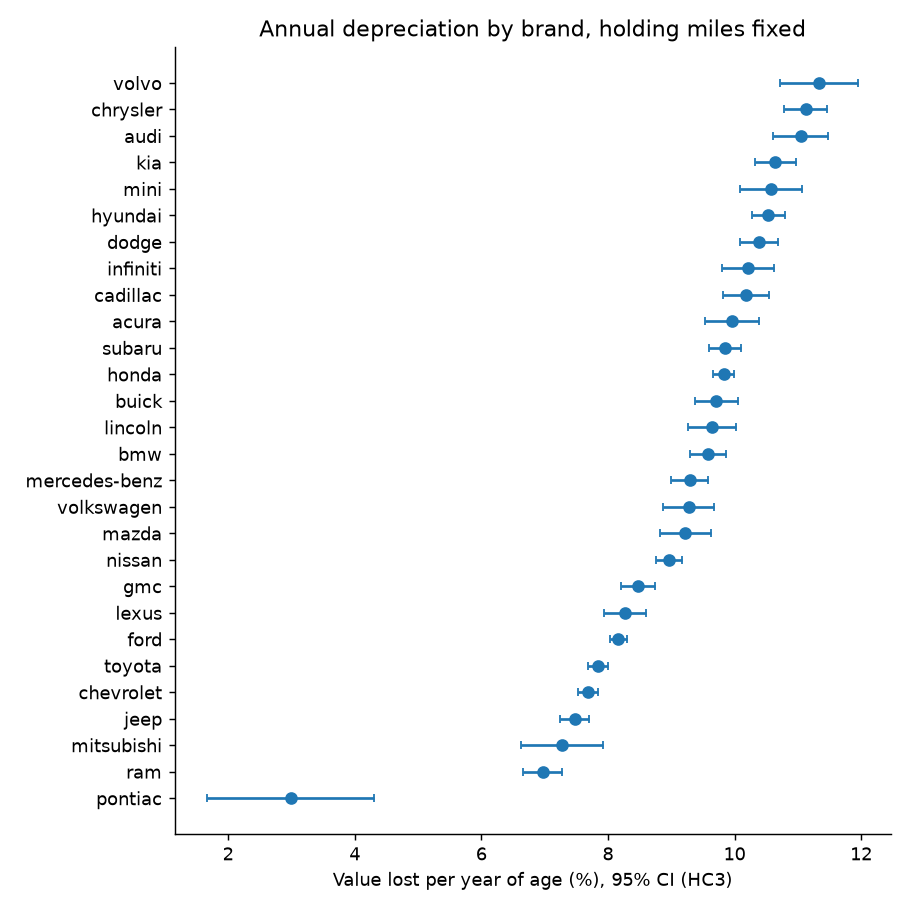

# How fast do used cars lose value, and does it depend on the brand?

OLS on log(asking price) for 181,282 Craigslist used-car listings (Apr–May 2021), with brand × age interactions and heteroskedasticity-robust (HC3) standard errors.

Data: [Kaggle "Craigslist Cars and Trucks Data"](https://www.kaggle.com/datasets/austinreese/craigslist-carstrucks-data) (`vehicles.csv`, 426,880 raw rows). Put it at `data/raw/vehicles.csv`; it is not committed.

## Findings

- **Cars lose roughly 7–11% of their value per year of age, holding mileage fixed**, and brand matters: Ram, Jeep and Chevrolet lose about 7%/yr, Toyota 7.8%, Honda 9.8%, Audi, Chrysler and Volvo about 11%. Most 95% CIs are about ±0.3 points wide ([fig 2](figures/fig2_brand_loss.png)).
- **Mileage adds little once age is in the model**: 10% more miles ≈ 1.4% lower price (age and log-miles are correlated 0.52, VIF 1.4).
- **Bay Area cars depreciate slightly more slowly**: about 0.5 pp/yr (p = 0.03, 1,681 listings), unchanged when restricted to cars posted in one region only (p = 0.04). Small sample and modest effect, so treat as suggestive, not settled.



## Model fit, honestly

| model | test RMSE (log) | test R² |
|---|---|---|
| age only | 0.669 | 0.419 |
| age + miles | 0.658 | 0.439 |
| brand × age + miles + body type | 0.573 | 0.574 |
| + age² | 0.570 | 0.578 |

80/20 split, seed 0. A typical prediction is off by a factor of about 1.8. This is an inference model for depreciation rates, not a good price predictor: it has no trim, condition or options.

Diagnostics ([fig 3](figures/fig3_residuals.png), `results/diagnostics.md`):
- Residuals are heteroskedastic (Breusch–Pagan p ≈ 0), which is why HC3 SEs are used.
- Residuals have a heavy **left tail**: some listings are priced far below the fit (likely down-payment prices or junk cars). It affects the intercept more than slopes, but it is real.
- Age is not perfectly linear in log price (mean residual is negative at ages 11–17, positive at 18+); adding age² helps only slightly.

## Cleaning

Every rule and its row count is in [`results/cleaning_log.md`](results/cleaning_log.md), generated by `src/clean.py`. The biggest drop is duplicates (≈170k rows): dealers repost the same car, which would otherwise count it many times. Brands with fewer than 1,000 listings are dropped. Listings with salvage/rebuilt titles are excluded. Region for national dealers is arbitrary, hence the `n_regions == 1` check.

## Limitations

- One snapshot (spring 2021, a used-car price spike), so it measures cross-sectional age differences, not true depreciation of a single car over time.
- Asking prices, not sale prices.
- Only 0.9% of rows are Bay Area.

## Reproduce

```bash
kaggle datasets download austinreese/craigslist-carstrucks-data -p data/raw --unzip
pip install -r requirements.txt
python -m src.clean && python -m src.eda && python -m src.model && python -m src.analysis
python test_clean.py
```
